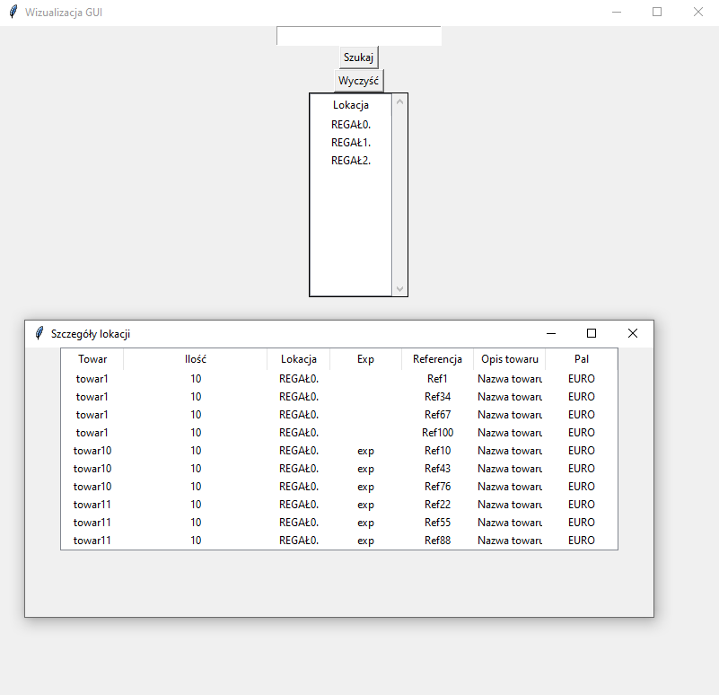

## Program do wyszukiwania indeksów po lokacji

Program służy do wyświetlania i wyszukiwania lokacji oraz powiązanych z nimi danych na podstawie informacji pobranych z pliku Excel.

## 📋 Spis treści

- [Opis](#opis)
- [Podgląd](#podgląd)
- [Funkcje](#funkcje)
- [Technologie](#technologie)
- [Uruchomienie](#uruchomienie)
- [Użycie](#użycie)
- [Struktura projektu](#struktura-projektu)
- [Autor](#autor)
- [Licencja](#licencja)

## 📖 Opis

Program pobiera dane z pliku Excel, a następnie wyświetla listę dostępnych lokacji w graficznym interfejsie użytkownika (GUI).

Użytkownik może wyszukiwać konkretne lokacje, a po dwukrotnym kliknięciu wybranej lokacji otworzyć dodatkowe okno zawierające szczegółowe informacje, takie jak indeks, ilość, lokacja, numer partii/serii oraz referencja.

Program posiada również mechanizm automatycznego odświeżania danych, dzięki czemu zmiany w danych mogą być na bieżąco wyświetlane w interfejsie.

## 🖼️ Podgląd

## ✨ Funkcje

- 📊 Odczytywanie danych z pliku Excel
- 🔎 Wyszukiwanie lokacji
- 📋 Wyświetlanie listy dostępnych lokacji
- 🖱️ Otwieranie szczegółów lokacji poprzez dwukrotne kliknięcie
- 📄 Wyświetlanie szczegółowych danych dotyczących wybranej lokacji
- 🔄 Automatyczne odświeżanie danych
- 🖥️ Graficzny interfejs użytkownika (GUI)
- 🧵 Obsługa danych w osobnym wątku

## 🛠️ Technologie

- Python 3.14.3
- pandas
- openpyxl

## ▶️ Uruchomienie

Uruchom główny plik programu:

python main.py lub uruchom.bat

## 💻 Użycie

Po uruchomieniu programu wyświetlone zostanie okno GUI zawierające listę lokacji na podstawie danych które są zaczytane z pliku dane.xlsx.

### 🔎 Wyszukiwanie lokacji

W polu wyszukiwania można wpisać nazwę lub fragment nazwy lokacji, a następnie kliknąć przycisk Szukaj.

Przycisk Wyczyść usuwa wpisany tekst i ponownie wyświetla wszystkie dostępne lokacje.

### 🖱️ Wyświetlanie szczegółów

Aby wyświetlić dane konkretnej lokacji, należy dwukrotnie kliknąć wybraną lokację na liście.

Program otworzy dodatkowe okno zawierające szczegółowe informacje dotyczące wybranej lokacji.

### 🔄 Automatyczne odświeżanie

Program sprawdza dostępność nowych danych w GUI co 1 sekundę, natomiast dane z pliku Excel są ponownie odczytywane co 10 sekund.

## 📁 Struktura projektu

...text
Magazyn_Zapas_Tkinter/
├── przykładowe_dane.xlsx
├── data.py
├── gui.py
├── main.py
├── README.md
├── thread.py
├── uruchom.bat
└── widok_programu.png
...

## 👤 Autor

Michał Banachiewicz

## 📄 Licencja

Projekt został utworzony w celach edukacyjnych / wewnętrznych.
